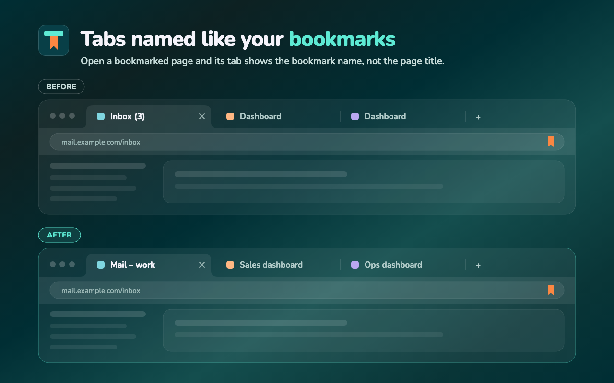

<div align="center">


# Bookmark-Tab Title

**Tabs named like your bookmarks.**

When the page in a tab is one of your bookmarks, the tab shows the bookmark's name instead of the page title.

[](https://github.com/bearvil/bookmark-tab-title/actions/workflows/ci.yml)
[](LICENSE)


Chrome · Edge · Opera · Brave · Vivaldi



</div>

## Why

Too many tabs called "Inbox", "Dashboard" or "Login"? Give them the names you already chose. Rename a bookmark to "Mail – work" and the tab is called exactly that, even when the page keeps changing its own title (like Gmail with its unread count).

## Features

- 🔖 **Bookmark name as the tab title** for every page you have bookmarked.
- ⚡ **Updates right away** when you add, rename or delete a bookmark. Deleting it restores the page's own title.
- 🧭 **Survives redirects and SPA navigation** within the same site (bookmark `example.com` → `example.com/login`). A page on another site never gets your bookmark name.
- 🎯 **Per-bookmark reach**: only the address, everything below it, pages containing a text, or the whole site.
- 📝 **Optional page title** after the bookmark name, e.g. "Mail — (3) Inbox", for all bookmarks or per bookmark.
- 🗂️ **Settings page** with your bookmarks by folder or as one list, filtered by reach and sorted as you like.
- 🔒 **Everything stays local.** No network requests, no analytics, no account.

## How it works

The tab URL is matched against your bookmarks: an exact match first, then ignoring the protocol, `www.`, the `#fragment` and a trailing `/`.

### How far a name reaches

Each bookmark has its own reach:

| Reach | What gets the bookmark's name |
|---|---|
| **Only this address** *(default)* | The bookmarked page itself. |
| **This address and below** | Once the tab has been on the bookmarked address, the pages under it: `example.com/docs` also names `example.com/docs/a/b`. |
| **Pages whose address contains** | Every page of the bookmark's host whose path, query or `#fragment` contains a text, in any tab, also for links opened from mail. Separate alternatives with a space. |
| **The whole site** | Once the tab has been on the bookmarked address, every page of that host. A non-default port is part of the host, so `localhost:3000` and `localhost:8040` are different sites. |

"Pages whose address contains" is made for multiple accounts on one site: `/u/1/` or `authuser=1` at Google, a Play Console `/developers/<id>`, a Cloud `project=<id>`.

<details>
<summary><b>Which bookmark wins</b></summary>

The most specific bookmark wins:

1. the bookmark of the page itself,
2. then "address contains",
3. then "this address and below" (the deepest one),
4. then the last "whole site" bookmark the tab came through.

A page with a bookmark of its own shows that name, and the next page returns to the "whole site" name. Leaving the host ends the trail; a link opened in a new tab keeps it.

</details>

### One setting, three places

- **Toolbar popup**: the bookmark of the current page, its name, its reach and the page title switch.
- **Settings page**: all bookmarks, by folder (collapsible, as in the browser) or as one list, filtered by reach and ordered as in the browser, by name, by site or by reach. The view, the order and the open folders are remembered on this device.
- **On and off**: one switch turns bookmark names in tabs off for all bookmarks (the toolbar button then says OFF), and each bookmark has its own switch in the popup and at the start of its settings row. A bookmark that is off names no page, and the settings page can filter for the ones that are off.
- **Settings file**: export the scopes and page title choices of all your bookmarks (also the ones left at the default) to a JSON file and import them, e.g. into another browser or from the development build into the store version. Settings belong to a bookmark's address, so they apply to every bookmark with the same address, also one added later. An import shows a summary first and only replaces the settings of the addresses in the file.
- **Right-click menu** on the page.

**Add the page's own title** is off by default. Turn it on for all bookmarks on the settings page, or per bookmark with the "Page title" switch, which overrides the global option. The tab then follows the page as its title changes. The bookmark name is left out of the page title when the page already has it at its start or end ("Inbox - Gmail" under "Gmail" becomes "Gmail — Inbox"), and markup in a page title is shown as its text.

## Install

The extension is not in a store yet. To load it from source:

1. Clone or download this repository.
2. Open `chrome://extensions` (Edge: `edge://extensions`, Opera: `opera://extensions`).
3. Turn on **Developer mode**.
4. Click **Load unpacked** and select the project folder.

## Development

Plain JavaScript, no build step. `npm install` only pulls in Playwright for the end-to-end tests.

```bash
npm install
npm test            # unit tests: URL matching, settings, settings file, texts, manifest
npm run test:e2e    # real Chromium with the extension and real bookmarks (HEADED=1 to watch)
npm run try         # visible Chromium with the extension and sample bookmarks, throwaway profile
npm run package     # store zip → dist/bookmark-tab-title-<version>.zip
```

Every test, by area: [docs/TESTS.md](docs/TESTS.md).

| Path | What it is |
|---|---|
| `manifest.json` | Manifest V3, minimal permissions |
| `src/match.js` | URL matching, no `chrome.*` (tested in Node) |
| `src/background.js` | Service worker: bookmark index and tab trail |
| `src/content.js` | Keeps `document.title` in place |
| `src/popup/`, `src/options/` | Toolbar popup and settings page |
| `src/ui/` | Design tokens and components ([docs/DESIGN.md](docs/DESIGN.md)) |
| `_locales/` | English and Croatian texts |

## Limitations

- Does not work on browser pages (`chrome://…`), in the Chrome Web Store or in the built-in PDF viewer, where browsers do not allow extensions to change content.
- After in-page (SPA) navigation inside a page opened from a bookmark, the bookmark name stays until the page loads a different URL.

## Privacy

No data is collected and nothing leaves your browser. Settings are stored with your browser's own sync storage. See the [privacy policy](https://bearvil.github.io/privacy-policies/bookmark-tab-title-pp).

## License

[MIT](LICENSE) © Bearvil
